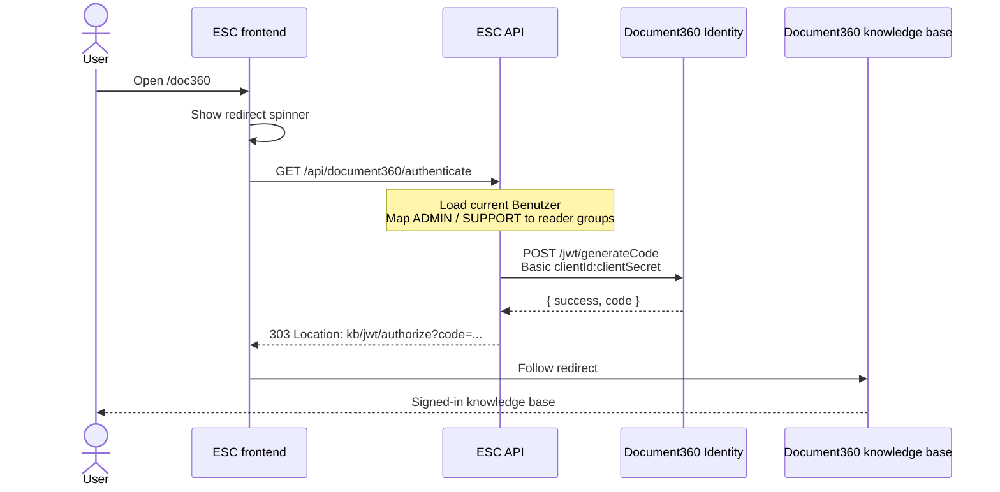

# Document360 JWT SSO

ESC signs users into the Document360 knowledge base with
[Document360 JWT SSO](https://docs.document360.com/docs/configuring-the-jwt-sso).
ESC never mints a Document360 JWT. It asks Document360 Identity for a **one-time `code`**
and redirects the browser to the knowledge-base login URL.

That `code` is the "Document360 token" used at runtime. Client ID and Client Secret are
long-lived credentials obtained once in the Document360 portal (see below).

## Sequence



## How to get a Document360 token

There are two different secrets in this flow. You need both.

### 1. Long-lived credentials (Client ID + Client Secret)

These are created once per Document360 project and injected into ESC.

1. Sign in to the Document360 portal as a project owner / admin.
2. Open **Settings → Users & Security → Authentication**.
3. Enable **JWT SSO** (not SAML / OpenID Connect).
4. Set the **login URL** to the ESC route that starts SSO, e.g. `https://<esc-host>/doc360`.
   Document360 only needs this so the knowledge-base "Sign in" button can send readers back to ESC.
5. Copy:
   - **Client ID** → `ESC_DOCUMENT360_CLIENT_ID` / `esc.document360.client-id`
   - **Client Secret** → `ESC_DOCUMENT360_CLIENT_SECRET` / `esc.document360.client-secret`
6. Note the knowledge-base host. The authorize URL is:
   `https://<your-kb-subdomain>.document360.io/jwt/authorize`
   → `ESC_DOCUMENT360_KB_LOGIN_URL` / `esc.document360.kb-login-url`
7. The code-generation URL is global and almost never changes:
   `https://identity.document360.io/jwt/generateCode`
   → `ESC_DOCUMENT360_CODE_GENERATION_URL` / `esc.document360.code-generation-url`

Store the Client Secret in the environment / secret store. Do not commit it.
Quarkus maps `ESC_DOCUMENT360_CLIENT_SECRET` onto `esc.document360.client-secret`.

### 2. Reader groups (content visibility)

JWT SSO assigns the signed-in reader to Document360 **reader groups**. Those groups
control which articles the user may see (tenant- / role-specific content).

1. In Document360 open **Settings → Users & Security → Reader groups**.
2. Create (or reuse) groups that match ESC roles, e.g. `ESC Admin` and `ESC Support`.
3. Copy each group's UUID.
4. Put the IDs into `Document360Service` (`READER_GROUP_ADMIN`, `READER_GROUP_SUPPORT`).

Current mapping:

| ESC `FachRolle` | Document360 reader group ID                    |
|-----------------|------------------------------------------------|
| `ADMIN`         | `9204a53c-0a8c-4cd3-9490-a6f18b048ad4`         |
| `SUPPORT`       | `edc1f98d-1b1b-4a76-87e2-6fb63bcdd7cc`         |

A user may receive both IDs. Users with neither still get an SSO `code`, but with an
empty `readerGroupIds` list (only public Document360 content).

### 3. Runtime one-time code (the actual login token)

ESC obtains this automatically when a signed-in user hits `/doc360`:

1. `Doc360PageComponent` does a **full-page** navigation to `GET /api/document360/authenticate`
   (not an XHR), so the browser can follow the redirect.
2. `Document360Resource` requires `EIGENE_BERECHTIGUNGEN_LESEN`.
3. `Document360Service` loads the current `Benutzer`, maps Fachrollen to reader groups,
   and POSTs to Identity:

```http
POST https://identity.document360.io/jwt/generateCode
Authorization: Basic base64(clientId:clientSecret)
Content-Type: application/json

{
  "userName": "user@example.org",
  "firstName": "Jane",
  "lastName": "Doe",
  "emailId": "user@example.org",
  "readerGroupIds": ["9204a53c-0a8c-4cd3-9490-a6f18b048ad4"],
  "tokenValidity": 3600
}
```

4. Identity returns `{ "success": true, "code": "<one-time-ticket>" }`.
5. ESC answers `303 See Other` with
   `Location: https://<kb>/jwt/authorize?code=<one-time-ticket>`.
6. Document360 consumes the code, creates the reader session, and shows the knowledge base.

`tokenValidity` is the Document360 session lifetime in seconds (currently 3600).
The `code` itself is short-lived and must not be stored.

## ESC configuration

| Property / env var | Purpose |
|--------------------|---------|
| `esc.document360.client-id` / `ESC_DOCUMENT360_CLIENT_ID` | JWT SSO Client ID |
| `esc.document360.client-secret` / `ESC_DOCUMENT360_CLIENT_SECRET` | JWT SSO Client Secret (required, no default) |
| `esc.document360.code-generation-url` / `ESC_DOCUMENT360_CODE_GENERATION_URL` | Identity `generateCode` URL |
| `esc.document360.kb-login-url` / `ESC_DOCUMENT360_KB_LOGIN_URL` | Knowledge-base `/jwt/authorize` URL |
| `quarkus.rest-client.document360-api.url` | REST client base URL (points at the generateCode URL) |

## Code map

| Piece | Role |
|-------|------|
| `frontend/.../doc360-page/doc360-page.component.ts` | Spinner page; assigns `location.href` to the API |
| `frontend/.../app.routes.ts` (`Path.DOC360`) | Route `/doc360`, guarded by `hasDoc360ViewBerechtigung()` |
| `Document360Resource` | `GET /api/document360/authenticate` → 303 |
| `Document360Service` | Role mapping + Basic auth + redirect URI |
| `Document360Client` | MP REST client for Identity |

## Limits (Document360)

- JWT SSO can only land the user on the knowledge-base home (the authorize URL).
  Deep links into a specific article are not part of this flow.
- Each consuming application needs its own JWT SSO client in Document360.
- Reader-group assignment is the mechanism for mandant- / role-specific content.
