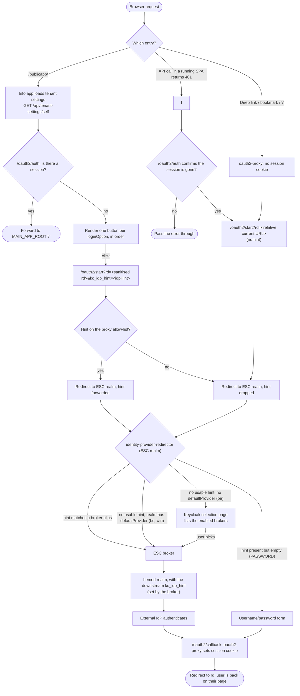
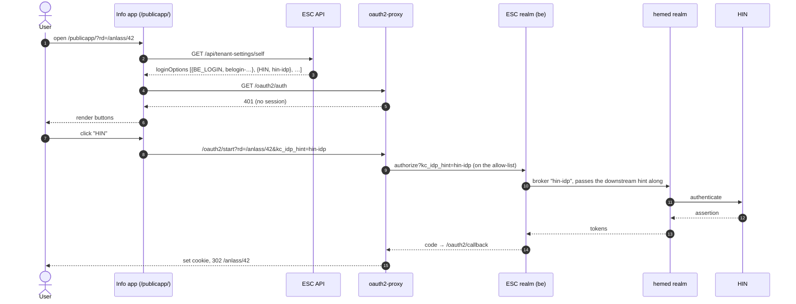
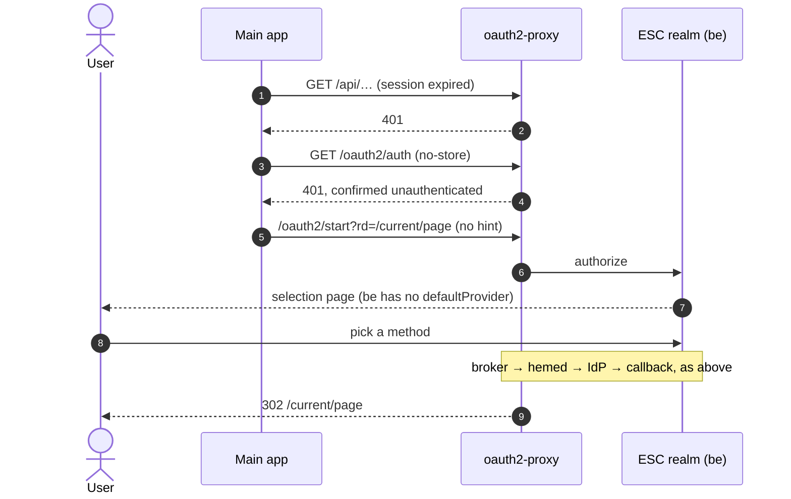
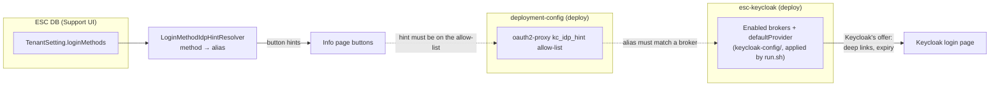
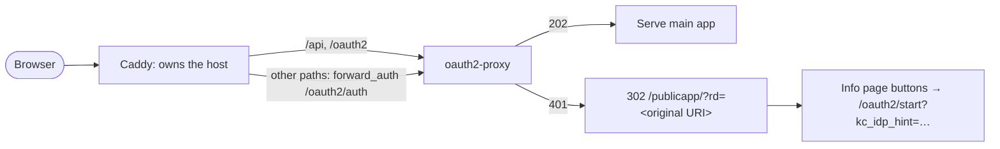

# Login flow

How a browser gets from "not logged in" to an authenticated ESC session. The reasons behind
this design are in [ADR 0001](adr/0001-keycloak-owns-login-method-selection.md).

## Actors

| Actor | Role |
|---|---|
| Main app (`/`) | Angular SPA. Has no login UI. `authSessionExpiredInterceptorFn` restarts the flow on 401. |
| Info app (`/publicapp/`) | Public branded page. One button per `TenantSetting.loginMethods` entry. |
| ESC API | `GET /api/tenant-settings/self` (public) returns `loginOptions` (`method`, `idpHint`, `order`), resolved by `LoginMethodIdpHintResolver`. |
| oauth2-proxy | Sits in front of `/` and `/api`. `/oauth2/start` passes `kc_idp_hint` only if it is on the allow-list. |
| ESC tenant realm (Keycloak) | `identity-provider-redirector` picks the broker: from the hint, else `defaultProvider`, else the selection page. |
| hemed realm (Keycloak) | Downstream. Never interactive (`hideOnLogin: true`). Every ESC broker passes along the hint for its IdP. |
| External IdP | BeLogin, HIN, AGOV, DV Bern Entra, Basel Entra, Winterthur ADFS. |

## Entry points

Key properties:

- **No dead ends.** If a hint is unknown, not on the allow-list, or has no matching
  broker, the user falls through to the realm's normal behaviour (`defaultProvider` or the
  selection page). Login never fails because of it.
- **`rd` is always relative.** It comes from `OAuth2ProxyService.toRelativeUrl()`, the
  only place that builds it, so the proxy never rejects it as an open redirect.
- **Re-authentication sends no hint.** After session expiry the realm decides again. On
  Bern that means the selection page. On Basel and Winterthur it takes zero clicks.

## Info page button click (Bern, HIN)

## Session expiry (Bern)

## Behaviour per tenant realm

| Realm | `defaultProvider` (ESC realm) | Downstream hint on the hemed IdP (`DEFAULT_HEMED_KC_IDP_HINT_<REALM>`) | No hint (deep link, expiry) | Info page buttons |
|---|---|---|---|---|
| be | empty | empty | Keycloak selection page with the visible brokers (`belogin`, `hin-idp`, hemed IdP). Username/password only on DEV/UAT. | Shortcuts that skip the selection page |
| bs | `REALM_IDP_HEMED_ALIAS` (plain hemed IdP) | empty in `.env-template`, so the hemed realm decides | Zero-click redirect to the hemed realm | Optional; usually redundant |
| win | `REALM_IDP_HEMED_ALIAS` (plain hemed IdP) | `?kc_idp_hint=WinterthurADFS` | Zero-click redirect to Winterthur ADFS | Optional; aliases must be on the allow-list |

### Where `defaultProvider` is configured

It is set in the ESC Keycloak, in the tenant realm, not in this repo. The esc-keycloak repo has
[keycloak-config-cli](https://github.com/adorsys/keycloak-config-cli) input files checked in
(`esc-keycloak/keycloak-config/`). They reconcile the `be`, `bs`, `win` and `dv` realms
against a running Keycloak. Apply them with `keycloak-config/run.sh`. Details are in
`keycloak-config/README.md`.

- `base/40-authentication-browser-hemed.json`: the `browser-hemed` flow. Its
  `hemed-redirector` (`identity-provider-redirector`) has
  `defaultProvider: "$(env:HEMED_DEFAULT_PROVIDER:-)"`.
- `run.sh` resolves `HEMED_DEFAULT_PROVIDER` per realm: it is empty for `be` and
  `REALM_IDP_HEMED_ALIAS` for every other realm. The override is
  `HEMED_DEFAULT_PROVIDER_<REALM>` (see `.env-template`).
- The `defaultProvider` of bs and win is the plain hemed IdP (`05-identity-provider-hemed.json`),
  not a tenant broker such as `basel-entra` or `WinterthurADFS`. The upstream IdP that it
  lands on is chosen by `DEFAULT_HEMED_KC_IDP_HINT_<REALM>`. That variable is appended to the
  hemed IdP's endpoint URLs; `.env-template` sets `?kc_idp_hint=WinterthurADFS` for win and
  leaves bs empty. For Basel to go straight to Basel Entra, set
  `DEFAULT_HEMED_KC_IDP_HINT_BS=?kc_idp_hint=basel-entra`, or
  `HEMED_DEFAULT_PROVIDER_BS=basel-entra` (the broker in `08-identity-provider-basel-entra.json`).
- Which brokers appear on the login page is set by `hideOnLogin`. Everything is hidden except
  `belogin`, `hin-idp` and the hemed IdP in `be` (`*_HIDE_ON_LOGIN_<REALM>` in `run.sh`).
- The `$(env:…)` placeholders are substituted by keycloak-config-cli. `${…}` does not work
  there.

After changing a value you have to run `run.sh` against that environment's Keycloak again.
This is the "changing the login offer means deploying Keycloak" consequence from ADR 0001.

## Two sources of truth

The three aliases must match byte for byte: the resolver alias (overridable via
`esc.login-method.<NAME>.alias`), the broker alias, and the allow-list entry. Enable a new
method in this order:

1. Add the broker in `esc-keycloak/keycloak-config/base/` and apply it with `run.sh`.
2. Add the alias to the allow-list in deployment-config, then run the curl smoke check:
   `/oauth2/start?rd=/&kc_idp_hint=<alias>` must return a `Location` header that contains
   the alias.
3. Add the method to `loginMethods` in the Support UI.

## Alternative: Caddy in front of oauth2-proxy (may be reconsidered)

The current design is not final. We may revisit it, especially if Support needs to change
the login offer without a Keycloak deploy, or if Bern wants the branded page as the only
front door. The original plan's prepared end state puts Caddy (`frontend/Caddyfile`) in
front of oauth2-proxy and lets Caddy check the session on the server with `forward_auth`:

Benefits:

- **One branded front door.** Deep links and `/` reach the info page, not the Keycloak
  page, so every tenant gets the same entry experience.
- **The login offer lives in one place.** Keycloak can hide all brokers
  (`hideOnLogin: true`), and `TenantSetting.loginMethods` becomes the only source of truth,
  editable at runtime by Support with no Keycloak deploy.
- **No SPA login gate.** The check runs on the server: no extra boot round trip, no bounce
  counter, and anonymous visitors never download the main-app shell.
- **Deep links and `/` behave the same**, without any JavaScript.

What switching would take:

1. Ingress change: the public ingress owns `/`, and the oauth2-proxy ingress is narrowed to
   `/api` and `/oauth2` (or Caddy reverse-proxies those two paths). Roll out per tenant,
   DEV Bern first.
2. A `forward_auth` block plus a per-release `OAUTH2_AUTH_URL` helm value in the Caddyfile.
3. Re-auth after expiry must replay the user's own hint (stored in the SPA, or read from an
   `identity_provider` claim); otherwise hidden brokers leave the user without a choice.
4. Then `hideOnLogin: true` on the ESC brokers, per environment.

Open issues: Caddy `redir` placeholders are not URL-encoded, so passing a query string in
`rd` needs a solution first. A cache must not store the 302 without varying on the cookie.
The SPA keeps its 401 interceptor for expiry during a session either way. The full design
is in `git show 4a601eb00:.junie/plans/public-landing-page-login-selection.md` (Steps 8
and 9).

## Pitfalls

- **`PASSWORD` sends `kc_idp_hint=` (present but empty).** Without the parameter, Keycloak
  falls back to `defaultProvider` and the password form never appears. In code, test the
  hint for presence (`!== null`), never for truthiness. In the allow-list, use
  `value: ""`.
- **The oauth2-proxy alpha config is strict.** An unknown key aborts startup.
  `injectRequestHeaders[].values[]` takes `claim`/`prefix` directly; a `claimSource:`
  wrapper fails to load.
- **The hemed realm must stay non-interactive** (`hideOnLogin: true`). Every ESC broker
  hardwires its downstream hint.
