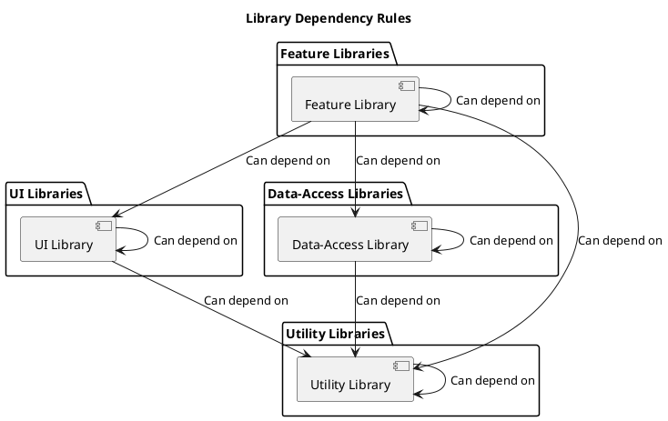

# Library Documentation

<!-- TOC -->
- [Library Documentation](#library-documentation)
  - [Library Types](#library-types)
    - [Feat](#feat)
    - [UI](#ui)
    - [Data-Access](#data-access)
    - [Util](#util)
  - [Naming Conventions](#naming-conventions)
    - [Shared](#shared)
    - [App specific](#app-specific)
    - [Feat](#feat-1)
    - [UI](#ui-1)
    - [Data Access](#data-access-1)
    - [Util](#util-1)
  - [Folder Structure](#folder-structure) \* [Directory Breakdown](#directory-breakdown)
  <!-- TOC -->

## Library Types

Libraries in this workspace are categorized by type, each serving a distinct role in the application's architecture.
Naming conventions and project tags are used to identify these types.
Explicitly defining the types also helps enforce dependency rules across projects using Nx.

Below are the four main types of libraries:

### Feat

Feature libraries contain "smart" components that interact with data sources.
They implement specific business use cases or application pages.
These libraries often include the application's logic.

### UI

UI libraries are responsible for presentational components, often referred to as "dumb" components,
which focus solely on visual representation without handling business logic or data access.

- **NEVER:**
  UI libraries should never contain business logic or handle data access.
  Their sole responsibility is to provide reusable visual components that focus on the user interface.

  **Example:**

```
❌ import { processPayment  } from 'shared/buttons/ui-buttons';

✅ import { ButtonComponent } from 'shared/buttons/ui-buttons';
```

### Data-Access

Data-access libraries handle interactions with backend systems, including API communication, stores and state management.
All files related to state Management are typically grouped in a `state` folder under the library's directory.

For data-access libraries, you have the option to choose if the library is a generated lib.
If so, the library will receive a generated:api tag, making it accessible to all other libraries and applications in the workspace.

### Util

Utility libraries contain low-level helper functions and code that are reused across other libraries and applications.

---

## Naming Conventions

### Shared

In every project, there is a folder named **shared**. This folder contains libraries that are shared across multiple applications.
In the folder shared, each library type (such as [ui](#ui), [data-access](#data-access), [feat](#feat), [util](#util)) **MUST**
be grouped under a corresponding top-level folder with the [library type](#library-types) as the folder name.

**Example of the shared folder with its libraries**:

```
libs
  ├── shared
  │   ├── ui
  │   ├── data-access
  │   ├── feat
  │   └── util
```

This helps maintain clarity and ensures that the libraries are easily recognizable and organized.

**NEVER:**

Direct Imports from shared.
It is never allowed to directly import libraries or classes from the top-level shared folder.
All libraries in the shared folder **MUST** be grouped under a subfolder according to their library type (e.g., ui, data-access, feat, util).
Direct imports from shared are prohibited to maintain clarity and enforce proper organization.

**Example:**

```
❌ import { MyClass } from 'shared';

✅ import { MyClass } from 'shared/ui/my-library';
```

### App specific

Additionally, each application **SHALL** have its own folder suffixed with `-app` (in this example, `my-app`).

If needed, new libraries of the four allowed types (`feat-*`, `ui-*`, `data-access-*`, `util-*`) **SHOULD** be created inside the `*-app` folder.

**MUST:**

Shared functionality across features.
If one feature in my-app needs to share functionality with another feature in the same app, the shared functionality
**MUST** be placed in the index.ts at the feature-root-level.

**For example:**

```
libs
  ├── shared
  ├── my-app
  │   ├── data-access-x
  │   ├── feat-x
  │   ├── feat-y
  │   |── feat-z
  |     └── src/index.ts (declare only the feature-entry-route and shareable functionality here)
```


### Feat

Feature libraries **MUST** always be grouped in a parent folder named with the prefix `feat-*`, where `*`represents the specific feature name.
Inside this parent folder, individual libraries **SHOULD** cover specific functionality related to the feature.

```
libs
├── shared
│   └── feat
│       ├── feat-auth
│       │   └── src
│       │       └── lib
│       │           ├── login-service
│       │           ├── auth-guard
│       │           └── auth-interfaces
│       └── feat-notifications
│           └── src
│               └── lib
│                   ├── notification-list
│                   └── notification-settings
├── my-app
│   └── feat-shop
│       ├── feat-cart
│       │   └── src
│       │       └── lib
│       │           ├── cart-items
│       │           └── cart-summary
│       └── feat-product
│           └── src
│               └── lib
│                   ├── product-list
│                   ├── product-detail
│                   └── product-reviews
```

### UI

**UI Libraries** **MUST** always use the prefix `ui-*`. Examples include:

- `ui-buttons`
- `ui-inputs`
- `ui-icons`

### Data Access

**Data-Access Libraries** **MUST** always use the prefix `data-access-*`. Examples include:

- `data-access-backend`
- `data-access-auth`

### Util

These libraries **MUST** use the prefix `util-*`.

- `util-angular`
- `util-testing`
- `util-ts`

---

## Folder Structure

This template outlines the directory structure for organizing an application and its libraries in a modular and scalable way.
The following structure demonstrates how my-app and shared libraries are organized, with flexibility to add more.
allowed types as needed.

### Directory Breakdown

**my-app**:

For each app-specific feature, there is a dedicated folder that may contain multiple libraries if needed. For example, a feature **x** will have a folder **feat-x**, which can include libraries such as **x1** and **x2**.


**shared**:

Contains libraries that are shared across multiple applications.

```
libs
├── my-app
│   ├── data-access-x
│   │   └── generated
│   │       └── src
│   │           └── lib
│   │               └── example-1
│   ├── feat-x
│   │   ├── x1
│   │   │   └── src
│   │   │       └── lib
│   │   │           ├── state
│   │   │               ├── example.state.ts
│   │   │               ├── example.actions.ts
│   │   │           ├── example-1
│   │   │           └── example-2
│   │   │               ├── example-2.component.css
│   │   │               ├── example-2.component.html
│   │   │               ├── example-2.component.spec.ts
│   │   │               ├── example-2.component.ts
│   │   │               ├── example-2.service.ts
│   │   └── x2
│   │       └── src
│   │           └── lib
│   │               └── example-1
│   ├── feat-y
│   │   └── y1
│   │       └── src
│   │           └── lib
│   │               ├── example-1
│   │               └── example-2
│   └── feat-z
│       └── z1
│           └── src
│               └── lib
│                   ├── example-1
│                   ├── example-2
│                   └── example-3
├── shared
│   ├── ui
│   │   ├── ui-x
│   │   │   └── src
│   │   │       └── lib
│   │   │           ├── example-1
│   │   │           └── example-2
│   │   └── ui-y
│   │       └── src
│   │           └── lib
│   │               └── example-1
│   ├── data-access
│   │   ├── data-access-x
│   │   │   └── src
│   │   │       └── lib
│   │   │           └── example-1
│   │   └── data-access-y
│   │       └── src
│   │           └── lib
│   │               ├── example-1
│   │               └── example-2
│   ├── feat
│   │   ├── feat-x
│   │   │   └── src
│   │   │       └── lib
│   │   │           ├── example-1
│   │   │           ├── example-2
│   │   │           └── example-3
│   │   └── feat-y
│   │       └── src
│   │           └── lib
│   │               └── example-1
│   └── util
│       ├── util-x
│       │   └── src
│       │       └── lib
│       │           └── example-1
│       ├── util-y
│       │   └── src
│       │       └── lib
│       │           ├── example-1
│       │           ├── example-2
│       │           └── example-3
│       └── util-z
│           └── src
│               └── lib
│                   ├── example-1
│                   └── example-2
```

---

**_NOTE:_** Install and activate Plant UML Integration plugin to see the diagram


